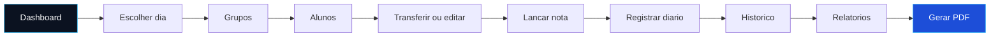
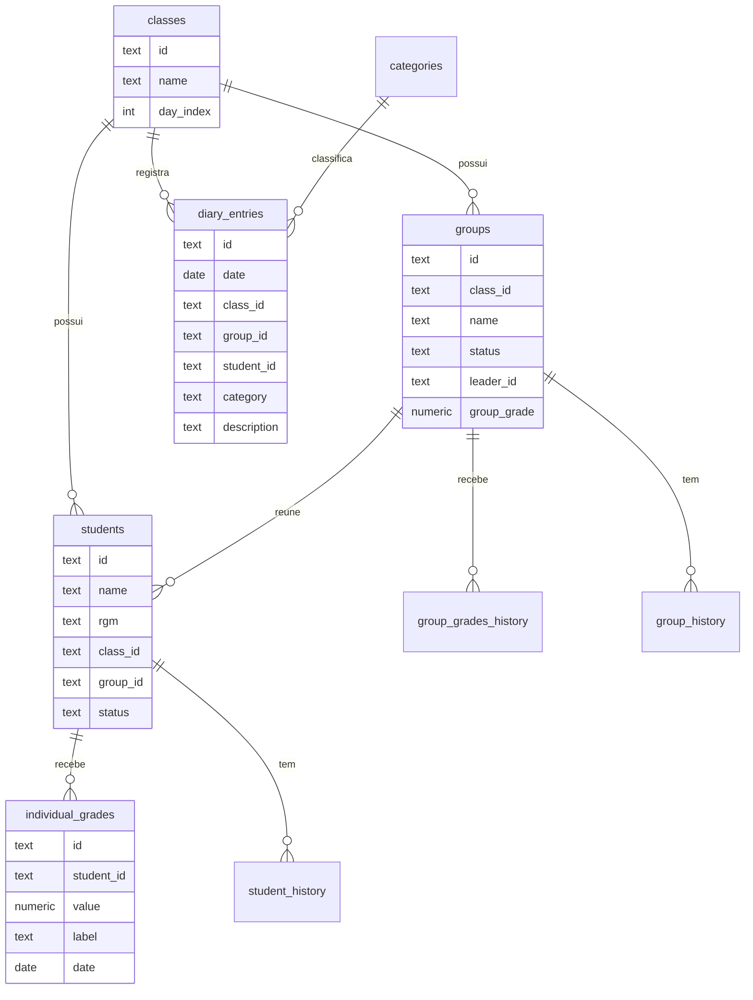

<div align="center">


<a href="https://github.com/callmekaue/gestor-de-turmas">
  
</a>

<br/>


<br/><br/>


<br/><br/>

[Sobre](#sobre) &nbsp;|&nbsp;
[Preview](#preview) &nbsp;|&nbsp;
[Recursos](#recursos) &nbsp;|&nbsp;
[Fluxo](#fluxo-principal) &nbsp;|&nbsp;
[Instalacao](#como-instalar) &nbsp;|&nbsp;
[Dados](#onde-ficam-os-dados) &nbsp;|&nbsp;
[Banco SQL](#modo-com-banco-sql-real) &nbsp;|&nbsp;
[Evolucao](#evolucao)

</div>

<br/>


## Sobre

O **Gestor de Turmas** e um sistema feito para o representante administrar, em um so lugar, as **6 turmas da semana (segunda a sabado)**. Ele organiza grupos dinamicos, alunos, lideres, notas individuais e de grupo, diario de ocorrencias e gera relatorios em PDF, tudo sem tela de login e sem etapa de instalacao.

<table>
<tr>
<td width="33%" align="center">


Duplo clique no `index.html`. Nao ha `npm install`, nem build.

</td>
<td width="33%" align="center">


Cadastre turmas, grupos e alunos direto pela interface.

</td>
<td width="33%" align="center">


Filtre por turma, grupo, aluno e periodo e gere o PDF.

</td>
</tr>
</table>

<br/>

## Preview

<div align="center">

<!--
  COMO TROCAR AS IMAGENS SEM CRIAR PASTA NO REPOSITORIO:
  1. No GitHub, abra este README no modo de edicao (icone de lapis).
  2. Arraste um print ou GIF para dentro do editor. O GitHub gera um link automatico.
  3. Substitua a URL do placehold.co abaixo por esse link.
  Dica: grave a tela com ScreenToGif ou LICEcap para gerar os GIFs.
-->


<sub>Dashboard: totais gerais, cards por dia, lideres, representantes e calendario de eventos.</sub>

<br/><br/>


<sub>Reorganizacao de grupos em quadro Kanban, com arrastar e soltar.</sub>

<br/><br/>

<table>
<tr>
<td align="center" width="50%">

<br/><sub>Evolucao de notas e linha do tempo de grupos</sub>
</td>
<td align="center" width="50%">

<br/><sub>Resumo, tabela de notas e tabela de diario</sub>
</td>
</tr>
</table>

</div>

<br/>

## Recursos

<table>
<tr>
<td width="50%" valign="top">

### Estrutura

- **6 turmas fixas** (segunda a sabado), cada uma com quantidade independente de grupos
- **Grupos editaveis**: criar, renomear, arquivar ou excluir, com protecao quando ha alunos ou historico
- **Alunos** com nome, RGM (validacao de duplicidade), grupo atual e observacoes
- **Lider de grupo** destacado com trofeu, alteravel, com registro automatico no historico
- **Representantes de turma** (2 a 3 por dia, distintos do lider de grupo)

</td>
<td width="50%" valign="top">

### Acompanhamento

- **Notas individuais e de grupo** tratadas como entidades separadas
- **Diario da turma** com data, turma, grupo e aluno opcionais, sem reescrever o contexto se o aluno trocar de grupo
- **Categorias livres** para o diario
- **Historico completo** de grupos, notas, lideres e alteracoes
- **Busca global** por nome, RGM ou nome de grupo

</td>
</tr>
<tr>
<td width="50%" valign="top">

### Painel e rotina

- **Dashboard** com totais, cards por dia, grafico de alunos por dia, lideres atuais e ocorrencias recentes
- **Onde a professora esta**: anotacao fixa por dia da semana
- **Calendario de eventos** com visao do mes, proximos eventos e cadastro rapido
- **WhatsApp com um clique** para lideres e representantes
- **Acoes rapidas**: novo aluno, novo grupo, lancar nota, registrar diario, gerar relatorio

</td>
<td width="50%" valign="top">

### Dados e relatorios

- **Central de relatorios** com filtros de turma, grupo, aluno, categoria e periodo
- **PDF real** com jsPDF e autoTable
- **Persistencia local** em `localStorage`, funcionando offline
- **Sincronizacao opcional** com Postgres via Supabase
- **Responsivo**, com sidebar colapsavel e animacoes discretas

</td>
</tr>
</table>

<br/>

## Fluxo principal



Qualquer alteracao de estrutura, como adicionar ou remover grupo, mudar a quantidade de grupos por dia, transferir aluno ou trocar lider, e feita inteiramente pela interface, sem mexer em codigo.

<br/>

## Conteudo da entrega

```text
gestor-de-turmas
  index.html     o sistema em si (abra para usar)
  schema.sql     script para criar o banco real no Supabase (opcional)
  README.md      este arquivo
```

<br/>

## Como instalar

Nao ha instalacao obrigatoria. O `index.html` e um unico arquivo autocontido que carrega **React, Chart.js, jsPDF** e, se voce conectar um banco, o **SDK do Supabase** a partir de CDNs publicas no momento em que e aberto. Basta salvar o arquivo em qualquer pasta do computador ou hospeda-lo em qualquer lugar.

## Como executar

De duplo clique no `index.html` ou abra com Chrome, Edge ou Firefox. A internet so e necessaria para carregar as bibliotecas na primeira abertura, depois elas ficam em cache. Nenhum dado seu e enviado para fora do computador, tudo roda localmente.

Se preferir servir por um servidor local (opcional, evita particularidades de `file://` em alguns navegadores):

```bash
npx serve .
```

Depois acesse o endereco indicado, por exemplo `http://localhost:3000`.

## Como gerar build

Nao ha etapa de build. O arquivo ja e o produto final, por isso a entrega nao depende de `npm install`, Vite ou TypeScript compilado. A escolha foi deliberada, para que o sistema abra e funcione imediatamente em qualquer computador, sem exigir Node.js. Veja [Evolucao](#evolucao) para o caminho rumo a uma stack com build.

<br/>

## Onde ficam os dados

Por padrao, tudo e salvo no `localStorage` do navegador, sob a chave `gestor_turmas_v1`. E rapido e funciona offline, mas os dados ficam presos aquele navegador e computador. Se voce hospedar o `index.html` e acessar de outro dispositivo, ele nao vera o que foi salvo no primeiro.

| Item | Onde fica |
| --- | --- |
| Modo local | chave `gestor_turmas_v1` no `localStorage`, como um unico objeto JSON |
| Credenciais do banco | chave `gestor_turmas_sb_config` no `localStorage`, enviada apenas ao proprio Supabase |
| Backup do modo local | Console (F12): `copy(localStorage.getItem('gestor_turmas_v1'))` |
| Backup do modo SQL | Table Editor ou SQL Editor do projeto Supabase |

Toda a logica de leitura e escrita fica isolada nas secoes comentadas **CAMADA DE ARMAZENAMENTO** e **SINCRONIZACAO COM BANCO SQL**, no topo do arquivo. Nenhum componente de tela acessa `localStorage` ou Supabase diretamente, todos passam pelas `actions.*` do componente `App`.

<br/>

## Modo com banco SQL real

Recomendado se for hospedar ou acessar de mais de um aparelho. O sistema sincroniza com **Postgres via Supabase**, gratuitamente e sem mexer em codigo, tudo pela interface.

<table>
<tr>
<td width="8%" align="center"></td>
<td>Crie uma conta gratuita em <b>supabase.com</b> e um novo projeto (cerca de 2 minutos para provisionar).</td>
</tr>
<tr>
<td align="center"></td>
<td>Abra <b>SQL Editor</b>, cole todo o conteudo do <code>schema.sql</code> e clique em <b>Run</b>. As tabelas sao criadas ja com as 6 turmas e as categorias padrao do diario.</td>
</tr>
<tr>
<td align="center"></td>
<td>Em <b>Project Settings, API</b>, copie a <b>Project URL</b> e a chave <b>anon public</b>.</td>
</tr>
<tr>
<td align="center"></td>
<td>No Gestor de Turmas, clique no icone de banco de dados na barra lateral (ou em <b>Relatorios, Conectar banco de dados</b>), cole a URL e a chave e clique em <b>Conectar</b>.</td>
</tr>
</table>

A partir dai, toda alteracao e salva automaticamente no banco. Qualquer navegador ou dispositivo conectado com a mesma URL e chave le e escreve nos mesmos dados, o que permite hospedar o sistema em Vercel, Netlify ou GitHub Pages com persistencia de verdade.

Se o banco cair, estiver mal configurado ou voce estiver offline, o sistema avisa (o icone fica vermelho) e continua funcionando normalmente com o `localStorage`. Nada trava.

> **Seguranca.** Como nao ha tela de login (por desenho, pensado para uma unica pessoa), o `schema.sql` libera leitura e escrita para a chave `anon` sem autenticacao. Isso e adequado para uso pessoal, mas qualquer pessoa que descubra sua URL e chave tambem poderia alterar os dados. **Nao publique essas credenciais** em lugares publicos, como um repositorio GitHub publico.

### Modelo de dados

Entidades mapeadas 1:1 entre o app (camelCase) e as tabelas SQL (snake_case) em `schema.sql`.



Tabelas auxiliares: `categories` (chave primaria `name`) e `app_meta` (`id = 'singleton'`, com a flag `is_demo` do banner de dados demonstrativos).

<br/>

## Dados de exemplo

O sistema abre **zerado**: as 6 turmas e as categorias padrao do diario ja existem, mas sem grupos, alunos, notas ou registros ficticios. Voce cadastra a turma real pela interface (**Acoes rapidas, Novo aluno / Novo grupo**, ou dentro de cada turma).

Para apenas testar, ha um gerador opcional em **Relatorios, Zona de dados, Carregar dados de exemplo**. Ele substitui tudo por alunos, grupos e notas ficticios e exibe o aviso **DADOS DEMONSTRATIVOS** enquanto estiverem ativos. Depois, use **Limpar tudo e comecar do zero** para voltar ao estado vazio. O gerador fica na funcao `seedDatabase()` e so roda quando voce clica no botao.

<br/>

## Evolucao

| Caminho | Como |
| --- | --- |
| Escritas mais granulares | Cada acao (`addStudent`, `transferStudent`, `setLeader` e outras) ja faz sua propria escrita no Supabase, entao da para trocar um upsert por uma stored procedure no Postgres regra por regra |
| Login e autenticacao | Adicione Auth do Supabase (e-mail e senha ou magic link), troque as politicas de RLS do `schema.sql` por regras com `auth.uid()` e envolva o Router com um guard de autenticacao |
| Stack com build | `npm create vite@latest gestor-turmas -- --template react-ts` e porte os componentes para `src/components`, `src/screens` e `src/services`, tipando as entidades como interfaces TypeScript |

Stack sugerida para a versao com build: **React, TypeScript, Vite, Tailwind, shadcn/ui, Recharts, Framer Motion, React Hook Form e Zod**. A logica de `actions` e de sincronizacao com o Supabase pode ser copiada quase sem alteracoes, pois o `@supabase/supabase-js` e o mesmo nos dois cenarios.

<br/>

## Tecnologias

<div align="center">


</div>

<br/>

## Autor

<div align="center">

**Cicero Kaue Alves da Silva**
<br/>
Estudante de Engenharia de Software

<a href="https://github.com/callmekaue">
  
</a>

</div>

<br/>


