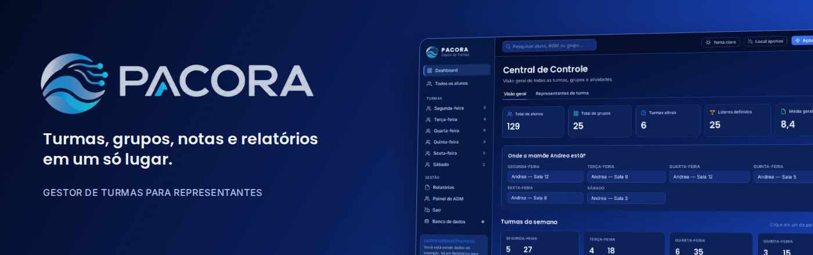
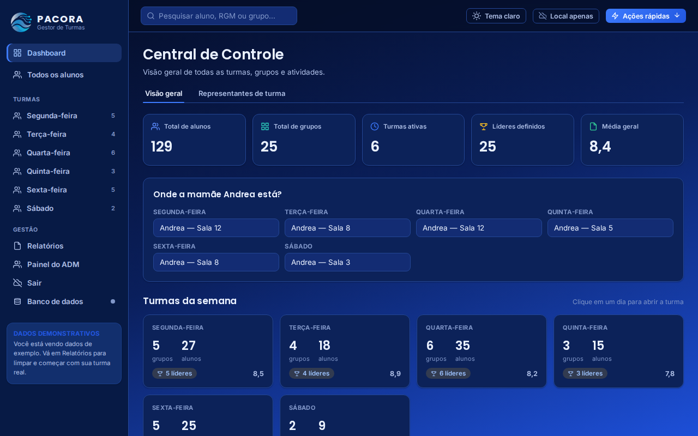
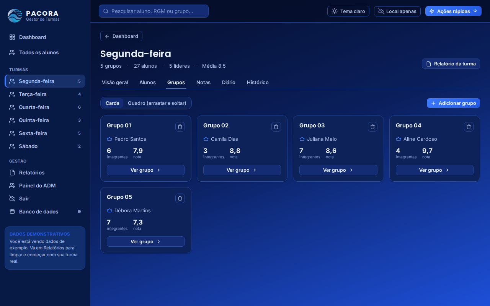
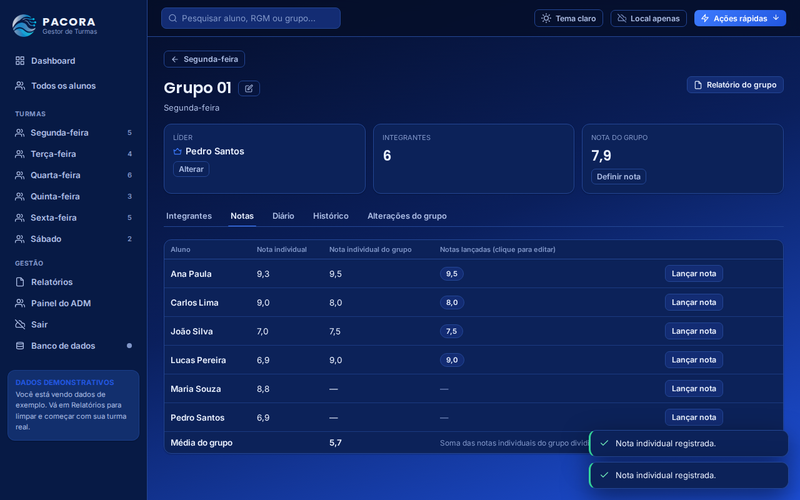
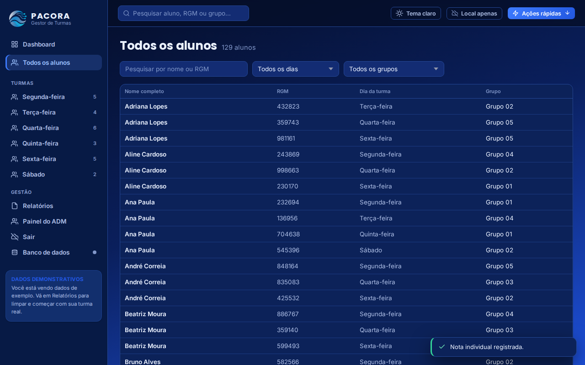
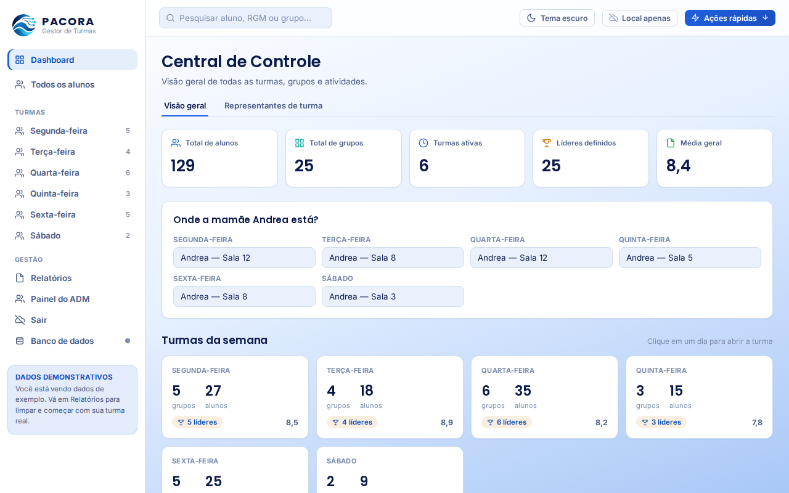
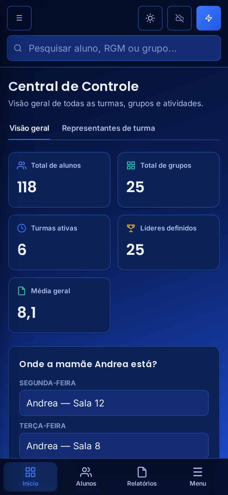
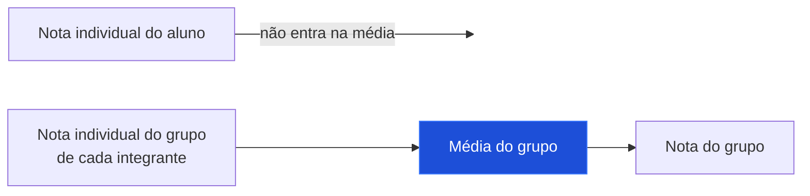
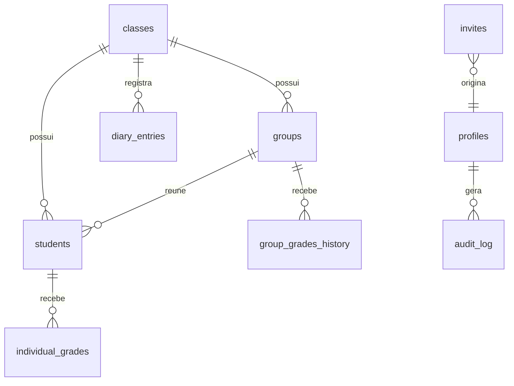

<!--
  Os arquivos de imagem citados aqui (pacora-*.png, shot-*.png e demo-*.gif)
  ficam na pasta pacora-readme-arquivos, ao lado deste README.
-->

  

<picture>
  <source media="(prefers-color-scheme: dark)" srcset="./pacora-readme-arquivos/pacora-logo-dark.png">
  
</picture>

  

**Turmas, grupos, notas e relatórios em um só lugar.**
 
Um sistema para o representante de turma organizar a semana inteira, de segunda a sábado.

 

  

[Sobre](#sobre) &nbsp;|&nbsp; [O sistema em uso](#o-sistema-em-uso) &nbsp;|&nbsp; [Recursos](#recursos) &nbsp;|&nbsp; [Acesso e permissões](#acesso-e-permissões) &nbsp;|&nbsp; [Publicar](#como-publicar) &nbsp;|&nbsp; [Banco de dados](#banco-de-dados)

 

## Sobre

A **Pacora** é uma central de controle para o representante administrar as **6 turmas da semana**. Em vez de planilhas e anotações soltas, tudo fica em um só lugar: grupos dinâmicos, alunos, líderes, três tipos de nota, diário de ocorrências, relatórios em PDF e um registro de tudo que foi alterado.

O sistema é um único arquivo `index.html`. Não tem instalação nem etapa de build: basta publicar o arquivo e conectar um projeto Supabase gratuito.

<table>
<tr>
<td width="33%" valign="top">

**Organizado**

Turmas de segunda a sábado, grupos que podem ser reorganizados por arrastar e soltar, líderes e representantes em destaque.

</td>
<td width="33%" valign="top">

**Justo**

Nota individual, nota individual do grupo e nota do grupo ficam separadas. A média do grupo usa só a nota individual do grupo.

</td>
<td width="33%" valign="top">

**Seguro**

Login por usuário, dois níveis de acesso, regras de segurança no banco e registro de atividades visível apenas ao administrador.

</td>
</tr>
</table>

 

## O sistema em uso

### Visão geral e grupos

 Dashboard, turma da segunda-feira e quadro de grupos com arrastar e soltar.

 

### Notas e média do grupo

 Notas individuais do grupo lançadas dentro do grupo e cálculo automático da média (quem não tem nota conta zero).

 

### Todos os alunos

 Listagem geral em ordem alfabética, com busca por nome ou RGM e filtros por dia e grupo.

 

### Tema escuro e tema claro

 O padrão é o azul-marinho com degradê royal. Um botão muda para o tema claro.

 

### No celular

 Barra de navegação inferior, tabelas em cartões e janelas que abrem de baixo para cima.

 

### Capturas de tela

<table>
<tr>
<td width="50%"> Dashboard</td>
<td width="50%"> Grupos da turma</td>
</tr>
<tr>
<td width="50%"> Notas do grupo</td>
<td width="50%"> Todos os alunos</td>
</tr>
<tr>
<td width="50%"> Tema claro</td>
<td width="50%" align="center"> Celular</td>
</tr>
</table>

As capturas usam os dados de exemplo do próprio sistema, por isso aparece o aviso de dados demonstrativos.

 

## Recursos

<table>
<tr>
<td width="50%" valign="top">

### Turmas e pessoas

- 6 turmas fixas, cada uma com quantidade própria de grupos
- Grupos em ordem natural (G1, G2 ... G10) e alunos em ordem alfabética
- Alunos com nome, RGM e histórico de grupos
- Líder de grupo e representantes de turma
- Listagem **Todos os alunos** com busca e filtros
- Onde a professora está e calendário de eventos

</td>
<td width="50%" valign="top">

### Notas e diário

- **Nota individual**, **nota individual do grupo** e **nota do grupo**
- Notas lançadas, editadas e removidas com confirmação
- Lançamento das notas dos integrantes direto no card do grupo
- Média do grupo calculada pelas notas individuais do grupo
- Diário da turma e do grupo, com edição dos registros

</td>
</tr>
<tr>
<td width="50%" valign="top">

### Relatórios

- PDF por turma, grupo ou aluno, com a logo da Pacora
- As três notas aparecem separadas e a regra da média vem explicada
- Tabela de grupos com a média e a nota coletiva
- Alunos sempre em ordem alfabética

</td>
<td width="50%" valign="top">

### Administração

- Painel do administrador com usuários, convites e conexão
- Registro de atividades: quem lançou, editou ou apagou cada nota
- Tema escuro e claro, com a escolha salva
- Layout pensado para celular

</td>
</tr>
</table>

### Regra das notas

A média do grupo soma a nota individual do grupo de cada integrante e divide pelo total de integrantes. Quem não tem nota lançada conta como 0. A nota individual do aluno é uma avaliação à parte e não participa dessa conta.

 

## Acesso e permissões

O acesso é feito por login, com dois níveis:

| Nível | O que pode fazer |
| --- | --- |
| **Administrador** | Tudo o que o representante faz, mais o painel do ADM: convidar e gerenciar usuários, configurar a conexão, sincronizar, consultar o registro de atividades e usar **Apagar os dados** |
| **Representante** | Gerenciar turmas, alunos, grupos, notas e diário. Não vê o painel e não apaga os dados do sistema |

**Convite com senha própria.** O administrador gera um convite com um link. O usuário abre o link, confere o e-mail e o código e cria a própria senha. Ninguém vê a senha, nem o administrador.

**Conexão embutida.** O administrador configura a URL e a chave `anon` uma única vez e baixa pelo painel um `index.html` com a conexão embutida. Depois de publicado, os usuários só digitam e-mail e senha.

 

## Como publicar

1. Crie um projeto gratuito no [Supabase](https://supabase.com) e rode o `schema.sql` no **SQL Editor**.
2. Publique o `index.html` em qualquer hospedagem estática (GitHub Pages, Netlify, Vercel).
3. Crie o primeiro usuário em **Authentication, Users** (ele vira administrador) e entre pelo endereço publicado.
4. No **Painel do ADM**, gere o arquivo com a conexão embutida, publique-o no lugar do atual e convide os representantes.

Para testar sem banco, o sistema também tem um modo local, com dados de exemplo opcionais, que salva apenas no navegador.

 

## Banco de dados

O `schema.sql` cria as tabelas, os perfis de acesso, o registro de atividades e as políticas de segurança (RLS). A chave `anon` não é uma credencial de administrador, e a chave `service_role` nunca é usada no navegador.

| Tabela | Função |
| --- | --- |
| `classes`, `groups`, `students` | Turmas, grupos e alunos |
| `individual_grades` | Notas individuais e notas individuais do grupo (campo `kind`) |
| `group_grades_history` | Histórico da nota coletiva do grupo |
| `diary_entries`, `events` | Diário de bordo e calendário |
| `profiles`, `invites` | Usuários, níveis de acesso e convites |
| `audit_log` | Registro de atividades, legível apenas pelo administrador |

 

## Tecnologias

 

## Autor

**Cicero Kaue Alves da Silva**
 
Estudante de Engenharia de Software

